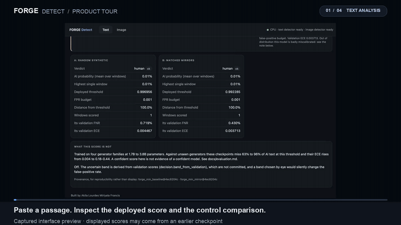
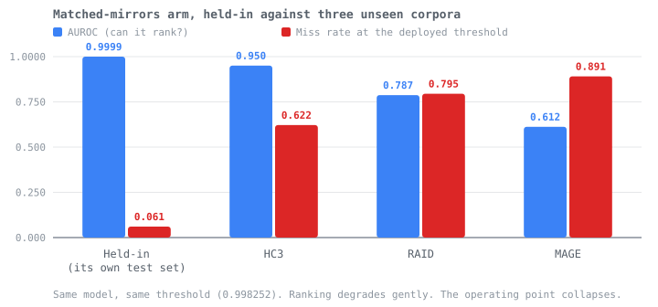
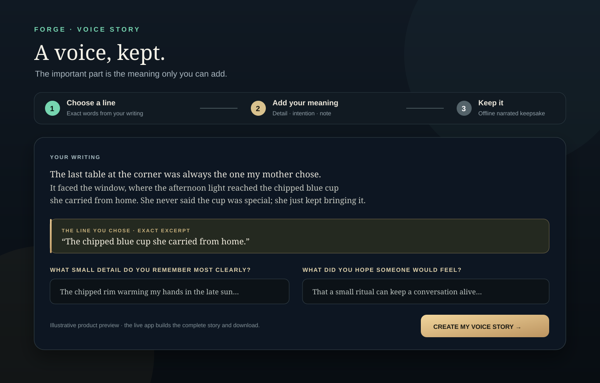
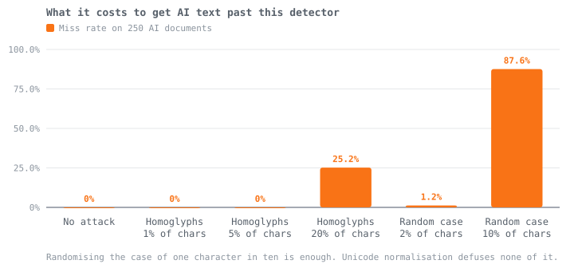
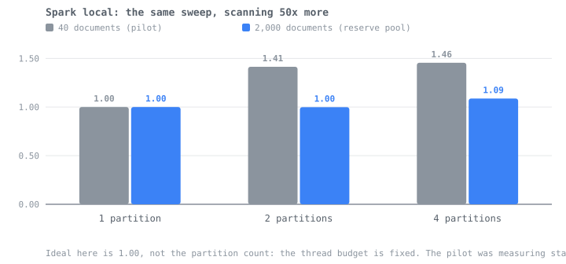

<div align="center">


### *Built by* **Akila Lourdes Miriyala Francis**

<p align="center">
  <a href="https://github.com/AKilalours/Forge/actions/workflows/ci.yml"></a>
  
  
  
  
  
</p>

<p align="center">
  <a href="https://github.com/AKilalours/Forge/actions/workflows/ci.yml"></a>
  
  
  
</p>

<p align="center">
  <a href="https://akilalours.github.io/Forge/"><b>Interactive evidence ↗</b></a> ·
  <a href="https://akilalours.github.io/Forge/tour/"><b>Guided app tour ↗</b></a> ·
  <a href="docs/evidence.md"><b>Current evidence</b></a> ·
  <a href="docs/evaluation.md"><b>Historical evaluation</b></a> ·
  <a href="docs/roadmap.md"><b>Readiness gates</b></a> ·
</p>

<p align="center">
  <a href="https://panagramforge-cqzwwskdjhbfv6hxwppvkz.streamlit.app"><b>▶ Live demo</b></a>
  <br/>
  <sub><i>Streamlit Community Cloud sleeps when idle. First load takes about two minutes
  while the container wakes and the checkpoint downloads. The evidence above does not.</i></sub>
</p>

<br/>

> **A controlled experiment, not a product claim.** Two detectors were trained that differ
> in exactly one thing: how their synthetic training half was produced. Everything else,
> the human corpus, the backbone, the schedule, the seed and the false-positive budget, was
> held fixed. This repository reports what that changed, including where it changed nothing.

<br/>

</div>

---

<p align="center">
  <a href="images/forge-product-tour.mp4"></a>
  <br/>
  <a href="https://akilalours.github.io/Forge/tour/"><b>▶ Explore the interactive six-step tour</b></a>
  · <a href="images/forge-product-tour.mp4"><b>Open the 14-second Text/Image capture</b></a>
</p>

<sub>Visual walkthrough assembled from real FORGE interface captures. The displayed capture scores are from an earlier checkpoint; current measured results are in the linked evidence page.</sub>

### The tour, chapter by chapter

Click any screen to jump straight to that step in the hosted tour.

<table>
  <tr>
    <td align="center" width="33%"><a href="https://akilalours.github.io/Forge/tour/#text"></a><br/><b>01 · TEXT</b><br/>Score a passage and compare detector arms.</td>
    <td align="center" width="33%"><a href="https://akilalours.github.io/Forge/tour/#image"></a><br/><b>02 · IMAGE</b><br/>Review a score beside file and provenance evidence.</td>
    <td align="center" width="33%"><a href="https://akilalours.github.io/Forge/tour/#robustness"></a><br/><b>03 · ROBUSTNESS</b><br/>Inspect scores under controlled image edits.</td>
  </tr>
  <tr>
    <td align="center" width="33%"><a href="https://akilalours.github.io/Forge/tour/#attribution"></a><br/><b>04 · ATTRIBUTION</b><br/>Explore explanatory heatmaps and pixel diagnostics.</td>
    <td align="center" width="33%"><a href="https://akilalours.github.io/Forge/tour/#evidence"></a><br/><b>05 · EVIDENCE</b><br/>Trace findings to benchmark artifacts and caveats.</td>
    <td align="center" width="33%"><a href="https://akilalours.github.io/Forge/tour/#voice-story"></a><br/><b>06 · VOICE STORY</b><br/>Choose an exact line, add your meaning, and export a keepsake.</td>
  </tr>
</table>

<sub>Text and Image are captured UI screens; Voice Story is an illustrated preview linked to the live app. Captured detector scores may lag current evaluation artifacts. The robustness panel is available through the FastAPI image route; it is not a separate Streamlit tab. The 14-second video predates Voice Story and captures Text/Image only.</sub>

---

**Does synthetic training text that mirrors real human documents beat synthetic text from
random prompts?** Two arms, one variable, three held-out benchmarks. It does, and the
winning model still misses most of the AI documents it meets.

| | AUROC in distribution | AUROC on HC3 | Missed on HC3, at its own threshold |
|---|---|---|---|
| Random prompts | 0.99999 | 0.796 | 87.5% |
| **Matched mirrors** | 0.99989 | **0.950** | **62.2%** |

Ranking transfers. The operating point does not. That gap is the project.

<p align="center">
  
</p>

<p align="center">
  
</p>

<sub>Both charts are rebuilt from <code>reports/experiments/</code> by
<code>scripts/build_readme_charts.py</code>, so a figure that disagrees with an artifact is
a bug with a reproduction rather than a picture nobody can check.</sub>

### It runs

<p align="center">
  
  <br/>
  <sub>One document, scored by both arms at once. Each arm carries its own deployed
  threshold, the false-positive budget it was fitted at, and its validation FNR and ECE,
  because a probability without them is decoration. The panel underneath states the
  out-of-distribution miss rate rather than hiding it.</sub>
</p>

<p align="center">
  
  <br/>
  <sub>A real photograph. The visual detector returns 0.92% and the file still carries its
  Canon EOS R6 Mark III fields, so the evidence agrees. C2PA and generation markers are
  reported as <b>not found</b> rather than as absence of AI, which is the distinction the
  banner wording turns on: this reads NO AI DETECTED, never HUMAN.</sub>
</p>

<sub>These captures show the running interface, but their checkpoint predates the current
evaluation. Treat displayed scores as interface examples; see
<a href="docs/evidence.md">the current evidence record</a> for measured results.</sub>

### Two runners, one machine, and a speedup column that means nothing

<p align="center">
  
</p>

<sub>Same pool, same 2,000 Common Crawl documents, same scan code, same host. Spark reports
a <b>1.09x</b> speedup at four partitions and Beam reports <b>3.29x</b>, and they land
within 16% of each other in absolute throughput. Beam's ratio is large because its
single-partition baseline is two and a half times slower, not because it parallelises
better. Artifacts in <code>reports/experiments/spark_reserve/</code> and
<code>reports/experiments/beam_reserve/</code>; the 40-document pilots both runners started
from are in <code>spark/</code> and <code>beam/</code>, kept because the disagreement between
the two sizes is the finding.</sub>

### Look at it

- **[The long-form record](docs/evidence.md)** — the full write-up, including each
  measurement I got wrong first and what the mistake was.
- **[reports/experiments/](reports/experiments)** — the committed JSON everything is
  built from.

### Voice Story · a human-led artifact

Forge's new **Voice Story** flow starts from a passage the writer chooses, offers exact
source excerpts, and asks the writer to explain what the detail means to them. It exports a
self-contained narrated keepsake using only their chosen words and answers. Pangram
segment signals and Reducto PDF/DOCX parsing are optional, require a separate consent action,
and never become an authorship verdict. A matching [Hermes reflection skill](.hermes/skills/forge-voice-story/SKILL.md)
helps guide the same one-question-at-a-time conversation.

```bash
pip install -e ".[demo,serve,hackathon]"
streamlit run streamlit_app.py
```

Set `PANGRAM_API_KEY` and/or `REDUCTO_API_KEY` in the environment or Streamlit secrets to
enable those optional provider calls. Without keys, the writing and keepsake flow works
locally with the fictional sample. The full interaction design and demo script are in
[docs/hackathon_story.md](docs/hackathon_story.md).

For an explicitly approved live integration check, set the keys privately in your local
environment, then run `python scripts/smoke_providers.py --provider both --confirm-external`
and type `SEND FICTIONAL SAMPLE`. It submits only the built-in fictional passage and a
generated fictional one-page PDF, and writes redacted metadata without storing content or
keys. This harness is not evidence of a live test until run with real credentials.

### Measured infrastructure evidence

The data path has also streamed and cleaned **5,638,371 Common Crawl documents** in
2.05 hours (762 documents/s) with four Spark workers on one laptop. The measured cleaning
policy retained 96,039 documents (1.70%); 90,948 were written to a reserve pool after
deduplication. This demonstrates a multi-million-document ingestion pass on one host. It
does not mean the detector was trained on millions of examples or that this was a
multi-node cluster run. The [crawl report](reports/experiments/crawl/spark/ab6890f623a36785-p4-s32.json)
and [evidence record](docs/evidence.md) include the rejected-document breakdown and
incomplete-segment disclosure.

Forge already has distributed-training microbenchmarks: FSDP on an A100 at 1/2/4 workers
and FSDP/DeepSpeed on L40S at 1/2 workers. The A100 run reached 254.5 examples/s at four
workers versus 65.0 at one (98% measured scaling efficiency). These are 12-step
microbenchmarks with synthetic batches, not end-to-end training over the full data
pipeline. The [raw reports](reports/experiments/scaling) carry hardware, precision,
global-batch, and memory details. Existing inference sweeps measure model forward only,
before tokenization and HTTP overhead; they are not serving SLOs.

The full FastAPI text path has now also been measured locally: 20 requests at each
concurrency level on macOS arm64, with 0 HTTP errors and valid scored-arm response schemas.
In the latest run, warm p95 was 370 ms at concurrency 1, 367 ms at 2, and 645 ms at 4;
the first request took 29.21 s while both models loaded.
This short probe is a reproducible baseline, not a production SLO. Its
[artifact](reports/experiments/serving/local_cpu_http.json) records all percentiles and
conditions; [the evidence record](docs/evidence.md) gives the caveats.

Measure the full HTTP path on a local service with a fixed fictional passage. The harness
defaults to localhost, records no input text, and requires explicit opt-in for remote hosts:

```bash
python -m uvicorn api.forge_app:app --host 127.0.0.1 --port 8000
python scripts/benchmark_serving.py
```

It reports first-request model-load time, warm p50/p95/p99 latency, throughput, status
codes, and errors at caller-selected concurrency levels (default 1/2/4). It supports
20–5,000 requests per point for bounded capacity profiles. Remote targets require the
explicit `--allow-remote` flag. See the [readiness gates](docs/roadmap.md) for the
production profile and its safety conditions; the committed Mac result is not an SLO.

### Run it

```bash
pip install -e ".[dev,serve,train,data]"
pytest tests/unit -q                      # the regression suite
python scripts/check_readme_claims.py     # fail if a published number drifted
python scripts/build_evidence_page.py     # rebuild the evidence page
python scripts/build_readme_charts.py     # rebuild this README's charts
streamlit run streamlit_app.py            # the deployed interface
```

The install command above is for the research and API tools. For the Streamlit interface,
install its extra too: `pip install -e ".[demo,serve]"`. `make serve` runs the same
working FastAPI app used by the container deployment.

### Scope, stated plainly

Trained on one corpus at one size. Both runners for the mining scan have only run on a
single machine, never a cluster. The adversarial lab finds a case-perturbation attack that
defeats the detector and that preprocessing cannot fix. None of that is hidden in the
long-form record; it is the reason the record exists.

*Akila Lourdes Miriyala Francis*
